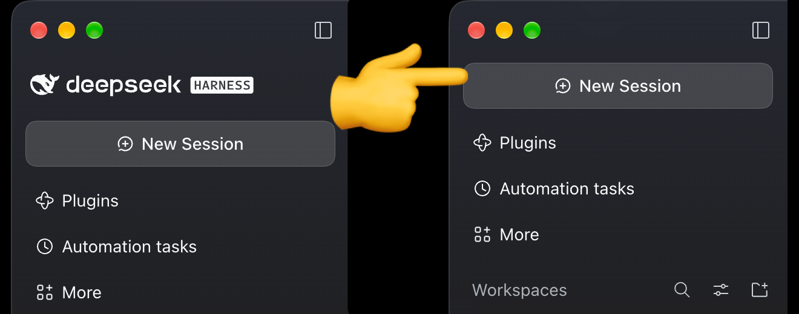

# remove-deepseek-logo

[](https://www.npmjs.com/package/remove-deepseek-logo) [](https://github.com/dlgrv/remove-deepseek-logo/actions/workflows/test.yml)



A DeepSeek Harness (DSH) plugin that removes the logo, brand name, version string,
and the conversation hero fish from the sidebar. The logo row collapses completely,
so the sidebar starts at the New Session button.

## Install

```sh
npm i remove-deepseek-logo
```

or in DSH: **Settings → Plugins → Add plugin** → `remove-deepseek-logo`

or from source: `github:dlgrv/remove-deepseek-logo`

Then add `remove-deepseek-logo` to `dsh.profile.bundles` in your profile's
`package.json` and restart DSH.

## How it works

- Registers empty occupants into the `sidebar.brand.mark`, `sidebar.brand.name`,
  and `conversation.hero.brand.mark` slots, replacing the official branding,
  its fallback, and the animated hero fish.
- Adds a safety-net stylesheet that hides the version string, any fish fallback,
  and collapses the logo row. Attribute selectors survive CSS-hash changes
  between DSH versions.

The plugin changes nothing on the host side: no model requests, sessions, or
tools are affected.

## Compatibility

DSH 0.2.x (tested on 0.2.2-rc.1).

## Development

```sh
npm test
```

## Uninstall

Toggle the bundle off on the Plugins page and remove the package. The original
branding returns after a restart.

## License

MIT
